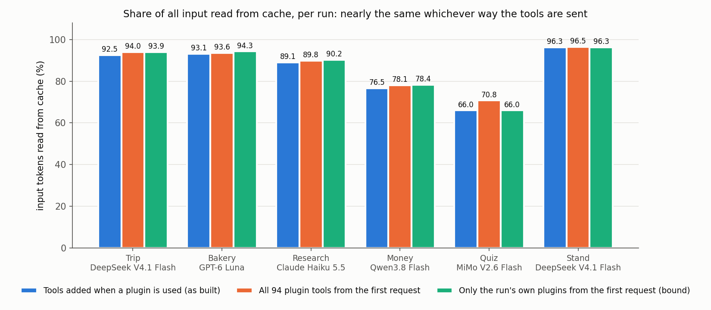
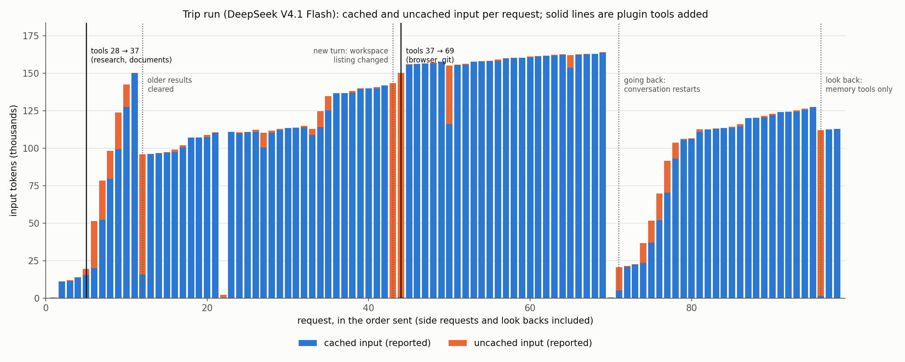

# Plugin tools and the prompt cache

A plugin's tools reach the model only once a conversation activates the
plugin (ADR 0016, ADR 0017). The request after an activation has a changed
tool list, so the provider's cache misses once. The alternative is to send
every plugin's tools from the first request, which keeps the tool list fixed.
This study measures which costs less.

Measured 2026-11-04 on six conversations, one per task below, 451 requests in
all. The data is each request as the app sent it and each provider's own
usage report: cached input, uncached input, cache writes and output. Costs
are computed from the signed model list's prices, checked that day against
each lab's pricing page, with DeepSeek at its off-peak rates. At the rates of
the hour each request was sent, the computed costs match the app's own cost
for five of the six conversations and come within 4% for the sixth. Costs
below are relative, so they hold as prices change in proportion.

| Run | Model | Requests |
| --- | --- | --- |
| Trip: three days planned, a PDF card and a phone page, then the city changed by going back | DeepSeek V4.1 Flash | 98 |
| Bakery: a website made | GPT-6 Luna | 27 |
| Research: a heat-pump subsidy researched | Claude Haiku 5.5 | 19 |
| Money: a year of bank spending charted | Qwen3.8 Flash | 16 |
| Quiz: a chapter turned into a quiz | MiMo V2.6 Flash | 8 |
| Stand: a charger stand designed in CAD and rendered | DeepSeek V4.1 Flash | 283 |

## In short

- **Adding tools when a plugin is used costs less.** Sending all 94 plugin
  tools from the first request would cost 9% more than the design as built,
  across the six runs. Five runs cost less as built; the trip run ties.
- **The cache rate barely changes.** 95.0% of all input is read from cache
  as built, 95.4% with every tool from the start. What decides the cost is
  the input itself: 54.3M tokens as built, 60.6M with every tool.
- **Activation's misses are small.** A design that sent each run's own
  plugins from the first request, which needs knowing them in advance,
  would cost 2% less in all. Most runs activate within their first five or
  six requests, while the conversation is still short.
- **About 10% of the cost is avoidable, by other changes.** Memory look
  backs on three labs, and the workspace listing changing between turns,
  break the cache for no gain. Fixing them would save that without changing
  what the model sees.

## Cost per run

Each design's cost against the design as built, with a cold cache: hits that
only an earlier recording of the same task could have supplied are removed.
"Own tools" sends each run's own plugins from the first request; it is a
bound, not a design the app could use. "No cache" is for scale.

| Run | All tools | Own tools | No cache |
| --- | --- | --- | --- |
| Trip | +0% | −10% | 8.5× |
| Bakery | +27% | −4% | 3.7× |
| Research | +43% | −1% | 4.5× |
| Money | +40% | −3% | 2.5× |
| Quiz | +57% | 0% | 2.2× |
| Stand | +1% | 0% | 9.0× |
| **All six** | **+9%** | **−2%** | **7.9×** |

Every tool from the start costs more for two reasons:

- Every request carries about 36k more tokens of tool definitions, read from
  cache or not.
- Every other cache break pays for those tokens in full: the first request,
  a changed listing, going back.

On the research run, the extra tokens push three requests past Claude Haiku
5.5's 100k-input price tier, where every rate is five times higher.

The trip run is the one where early tools would help. Its browser joined in
the second turn, when the conversation was already 143k tokens long, so that
one miss was expensive. Even there, every tool from the start only breaks
even.

The quiz run reads least from cache because it is eight requests long: its
uncached first request, 11k tokens, weighs a lot. Of the input that had
already been sent and could be cached, it reads 83%.

## Where the cache breaks

What each break cost beyond reading the whole previous request from cache,
as a share of the run's cost as built. 45 of the 440 conversation requests
did not extend the one before.

| Run | Plugin activation | Look back | Listing changed | Clearing, condensing | Going back |
| --- | --- | --- | --- | --- | --- |
| Trip | 11.1% (2×) | 7.9% | 9.8% | 6.2% (6×) | 1.5% |
| Bakery | 4.1% | – | – | – | – |
| Research | 1.1% | – | – | 0.1% | – |
| Money | 3.0% | 16.6% | – | – | – |
| Quiz | – | 24.7% | – | – | – |
| Stand | 0.3% | 11.5% (3×) | – | 10.1% (24×) | – |

- **Plugin activation.** The plugin's tools join the middle of the tool
  list, and every provider renders tools before the conversation, so the
  next request misses everything after them, once. Around each activation
  the share read from cache is 46–80% in the five requests before, 0–9% at
  the change (money: 45%) and 75–100% in the five after. A conversation that
  has not activated a plugin carries only a line about it.
- **Memory look backs on DeepSeek, Qwen and MiMo.** A look back is sent with
  only the memory tools, so its tool list differs from the turn's and it
  misses the whole conversation. Anthropic (`tool_removal`) and OpenAI
  (`allowed_tools`) restrict the tools without changing the list, and their
  look backs read 98–99% from cache; on the other three labs they read
  65–78%. Keeping the turn's tools would save about 9% of the six runs'
  cost, four fifths of it in the stand run.
- **The workspace listing.** The fixed start holds the folder's top-level
  listing and is rebuilt at each turn. A turn that starts after files were
  added changes it and misses everything, once in the trip run. ADR 0016's
  list of deliberate changes to the fixed start does not include this one.
- **Clearing and condensing** drop old results to keep later requests
  short. Each costs one miss, which the shorter requests that follow repay.
- **Going back** restarts the conversation from the edited message, so it
  misses once by nature.

## How each provider caches

From each lab's documentation, and from the recorded requests where the
documentation is silent:

- **DeepSeek.** An automatic prefix cache on disk, best effort, kept for "a
  few hours to a few days". Hits come in steps of 128 tokens. The system
  message is rendered before the tools: a change in it at character 777
  read nothing, with the tools unchanged. A hit costs about 2% of a miss.
  The trip ran at DeepSeek's weekday peak, when every rate is doubled, so at
  the hour it ran it cost twice what the off-peak rates give.
- **OpenAI.** The whole rendered prefix must match. Writes cost 1.25× the
  input price and reads 0.1×; every uncached token is reported as a write.
  An `additional_tools` input item adds tools at the end of the context,
  which keeps the prefix.
- **Anthropic.** Caches at the marks the request sets; Zhiyin sets at most
  four. Tools render before the system prompt and messages. A miss is a
  write at 1.25×, and a read costs 0.1×. Tools sent with `defer_loading` and
  brought in by `tool_reference` stay out of the prefix: "the prefix is
  untouched, so prompt caching is preserved."
- **Qwen.** An implicit prefix cache with a 1,024-token minimum. Hits come
  in steps of 256. Tools are rendered first: 7,168 tokens survived a change
  at tool 23, and none a change at tool 0.
- **MiMo.** Xiaomi's pages did not load. The recorded requests show
  automatic prefix hits in steps of 256, no write charge, and nothing read
  once the tool list changed.

Only Anthropic and OpenAI document a way to add tools without touching the
prefix. Using it would remove nearly all of activation's cost on those two
labs (4% of the bakery run, 1% of research), with no extra tokens.

## Rates

Each model's prices are those of the signed model list
(`packages/feature/model-client/model-list/models.json`), checked 2026-11-04 against
DeepSeek's, OpenAI's and Anthropic's pricing pages. Qwen's and Xiaomi's
official pages did not load that day, so their rates were checked against
third-party listings.

## Assumptions

- **Size of the added tools.** It is estimated from each run's first
  request, at 2.8–5.8 characters per token depending on the model's
  tokenizer. At ±20%, the "own tools" total moves by up to 1% and the "all
  tools" total by up to 10%; every tool from the start costs more than the
  design as built throughout that range.
- **Same model behaviour.** In the other designs the model makes the same
  calls, outputs and turns. Whether many tools change how well it chooses
  was not measured; Anthropic's documentation says the choice degrades past
  30–50 tools.
- **"All tools" is a lower bound.** It counts only tools seen in these
  recordings.
- **The cold cache.** Earlier recordings of the same tasks had left parts of
  the first requests in the cache, worth about 1% of the total; they are
  removed. A person gets that benefit only when starting several
  conversations in one folder on one day.
- **"No cache"** bills every cached token at the uncached rate, with output
  and writes unchanged.
