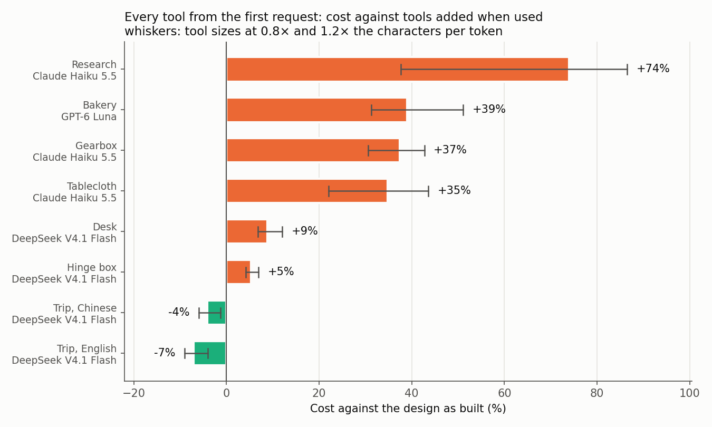
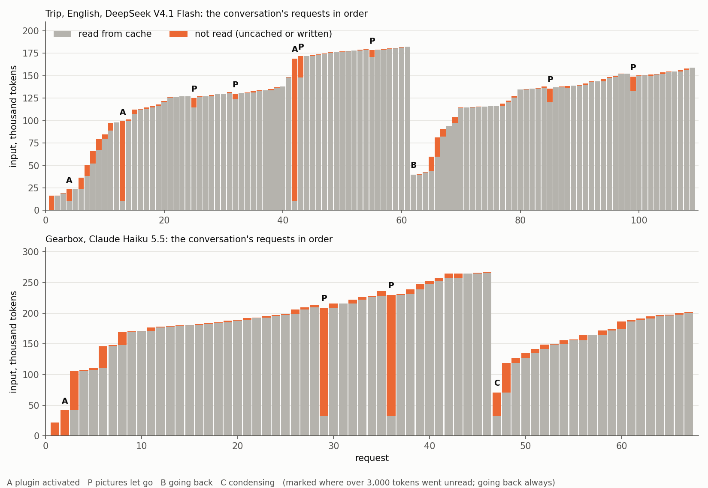

# Plugin tools and the prompt cache

A plugin's tools reach the model only once a conversation activates the
plugin (ADR 0016, ADR 0017). Opening a catalog entry activates its plugin,
and the plugin's core tools join the tool list. A toolkit, at most ten tools
for one kind of work, loads when the model opens it: natively where the lab
can add a tool mid-conversation (Anthropic, OpenAI from GPT-5.4, Kimi K3 and
K3.1 Pro), elsewhere through a bridge, where `open` returns the toolkit's
schemas as text and `call` runs them. The request after an activation has a
changed tool list, so the provider's cache misses once. The alternative is to
send every plugin's tools from the first request, which keeps the tool list
fixed. This study measures which costs less, and where the cache breaks.

Measured 2026-11-18 on eight conversations taped 12 to 17 November 2026,
688 requests in all. The data is each request as the app sent it and each
provider's own usage report: cached input, uncached input, cache writes and
output. Costs are computed from the signed model list's prices, checked that
day against each lab's pricing page, with DeepSeek at its off-peak rates. At
the rates of the hour each request was sent, the computed cost equals the
app's own for all 609 answers the app saved; look backs, side requests and a
few others are not saved, and are priced the same way. Costs
below are relative unless marked, so they hold as prices change in
proportion.

| Run | Model | Requests | Cost | Input | Read from cache |
| --- | --- | --- | --- | --- | --- |
| Trip: three days planned, a PDF card and a phone page, then the city changed by going back | DeepSeek V4.1 Flash | 111 | $0.19 | 13.9M | 96.2% |
| Trip in Chinese: the same request, asked in Chinese | DeepSeek V4.1 Flash | 156 | $0.25 | 20.6M | 96.5% |
| Bakery: a website made | GPT-6 Luna | 31 | $0.03 | 1.4M | 93.8% |
| Research: a heat-pump subsidy researched | Claude Haiku 5.5 | 13 | $0.19 | 1.4M | 87.0% |
| Desk: a writing desk of about 40 objects built in 3D, checked by a scene reviewer | DeepSeek V4.1 Flash | 118 | $0.20 | 15.4M | 96.6% |
| Hinge box: a print-in-place box designed in CAD | DeepSeek V4.1 Flash | 124 | $0.38 | 16.7M | 97.5% |
| Gearbox: a two-stage gearbox designed in CAD | Claude Haiku 5.5 | 75 | $1.47 | 12.4M | 92.9% |
| Tablecloth: a tablecloth pulled from a laid table, simulated and animated | Claude Haiku 5.5 | 60 | $0.70 | 7.4M | 93.7% |
| **All eight** | | **688** | **$3.42** | **89.3M** | **95.7%** |

The desk and hinge box ran entirely in DeepSeek's weekday peak, and the trips
mostly (62 of 111 and 102 of 156 requests). At the rates of the hour they ran,
they cost $0.41, $0.75, $0.31 and $0.43. Each trip is one conversation: the
first session up to the going back, then the same conversation carried on
live later that day.

## In short

- **Adding a plugin's tools when it is used costs less.** Sending all 149
  tools of the five built-in plugins from the first request would cost 28%
  more across the eight runs. Six runs cost more, by 5% to 74%; the two
  DeepSeek trips cost 4% and 7% less.
- **The cache rate barely changes.** 95.7% of all input is read from cache as
  built, 97.0% with every tool from the start. What decides the cost is the
  input itself: 89.3M tokens as built, 120.9M with every tool.
- **An activation is cheap early and dear late on DeepSeek.** A DeepSeek
  request whose tool list changed reads the system prompt and the tools
  before the change, and none of the conversation. The two document tools
  added for the PDF card cost the trips 6.9% and 5.3%; the engineering
  plugin's 78 tools, added later still, 10.8% and 9.2%. The size of what
  joins hardly matters; the length of the conversation does.
- **Look backs and the workspace listing no longer break the cache.** Each
  look back is sent the turn's own tools and reads nearly all of its input
  when nothing else changed. The system prompt stays the same in every
  request of every run.
- **Toolkits keep the cache on both routes.** The request after a load read
  the whole previous request, natively on Claude and through the bridge on
  DeepSeek. Adding the opened tools at the end of the list instead would have
  cost the two DeepSeek 3D runs 2% and 11% more.
- **The largest avoidable costs are elsewhere.** Letting go of old pictures
  cost 8.2% of the eight runs. On Claude most of it was matching input the
  provider never looked at: 14.6% of the gearbox run. A quiet correction taken
  back early in the conversation cost the tablecloth run 9.5%.
- **The engineering plugin's 78 tools are mostly GitHub's.** GitHub's 46
  tools are 72% of their characters, the browser's 22 are 20% and Git's 10
  are 8%. Splitting the browser and Git into toolkits changes the cost by
  −1% to +1%; leaving GitHub out of the activation saves 3% on the trips and
  11% on the bakery.

## Cost per run

Each design's cost against the design as built, with a cold cache: hits that
only an earlier recording could have supplied are removed. Each design is one
the app can run, or can run with a change to a declaration: "Toolkits at the
end of the list" is the route the agent loop takes when told to, which no
setting selects today; the two engineering columns need the browser and Git
to declare toolkits, and the last one also GitHub in a plugin of its own. A
dash means the design changes nothing in that run. "No cache" is for scale.

| Run | Every tool from the start | Toolkits at the end of the list | Browser and Git in toolkits | And GitHub out of the activation | No cache |
| --- | --- | --- | --- | --- | --- |
| Trip | −7% | – | −1% | −3% | 11.5× |
| Trip in Chinese | −4% | – | 0% | −3% | 12.4× |
| Bakery | +39% | – | +1% | −11% | 4.4× |
| Research | +74% | – | – | – | 3.8× |
| Desk | +9% | +2% | – | – | 11.8× |
| Hinge box | +5% | +11% | – | – | 7.4× |
| Gearbox | +37% | – | – | – | 4.5× |
| Tablecloth | +35% | – | – | – | 5.3× |
| **All eight** | **+28%** | **+1%** | **0%** | **−1%** | **6.3×** |

Where every tool from the start costs more, it is for two reasons:

- The 149 tools are about 300,000 characters: some 74,000 tokens on
  DeepSeek, 59,000 on GPT-6 Luna and 104,000 on Claude Haiku 5.5. Every
  request that carries the conversation's tools carries them all, against 29
  to 115 tools as built, read from cache or not.
- The first request pays for them in full.

On Claude Haiku 5.5 most requests are past the 100,000-token price tier even
as built, and with every tool all of them are, so the extra tokens are read
and written at five times the base rates. The first request alone writes
about 87,000 more tokens, 6.6 cents more. The research run is twelve requests
long, so that write weighs most: it costs 74% more.

The trips are where early tools help. A DeepSeek cache hit costs 2% of a
miss, so carrying up to 74,000 more cached tokens per request costs little,
while the trips' activations, two of them past 98,000 tokens of
conversation, missed 18% and 15% of the two runs' cost.

The engineering columns keep ten browser tools as core: preview, screenshot,
evaluate, resize, snapshot, click, navigate, console messages, wait and stop
preview. The rest of the browser forms two toolkits and Git one. A run that
uses a tool outside the core pays one more round to open its toolkit, and its
definitions join the conversation: the bakery opened both browser toolkits,
the Chinese trip one.

## Where the cache breaks

What each break cost beyond reading the whole previous request from cache,
as a share of the run's cost as built. 51 of the 666 conversation requests
did not extend the one before, besides the first request of each
conversation and of each specialist's run.

| Run | Plugin activation | Pictures let go | Quiet correction taken back | Condensing | Going back | Look backs | Side requests and specialists |
| --- | --- | --- | --- | --- | --- | --- | --- |
| Trip | 18.4% (3×) | 5.9% (6×) | 0.2% (2×) | – | 0.0% | 3, read 99.8% | 0.1% |
| Trip in Chinese | 14.8% (3×) | 6.5% (8×) | 0.0% (2×) | 1.4% | 0.0% | 8, read 98.0% | 0.0% |
| Bakery | 4.7% | – | – | – | – | 3, read 99.3% | 0.1% |
| Research | 1.3% | – | – | – | – | 3, read 98.3% | 0.0% |
| Desk | 0.4% | 10.0% (3×) | 0.4% (3×) | 2.9% | – | 6, read 90.7% | 7.5% |
| Hinge box | 0.2% | 4.5% (3×) | 0.0% | 2.1% (2×) | – | 10, read 97.9% | 4.3% |
| Gearbox | 0.2% | 14.6% (2×) | 0.1% | 0.3% | – | 8, read 99.1% | 0.4% |
| Tablecloth | 0.4% | – | 9.5% | – | – | 7, read 89.2% | 1.5% |
| **All eight** | **2.4% (12×)** | **8.2% (22×)** | **2.0% (10×)** | **0.6% (5×)** | **0.0% (2×)** | | |

- **Plugin activation.** The plugin's core tools join the middle of the tool
  list, after the file, shell and chart tools. Anthropic and OpenAI render
  the tools first, so the request after an activation read nothing from
  cache. DeepSeek renders the system message first: wherever only this
  conversation could have supplied the cache, it read the system prompt and
  the first 23 tools, 10,496 to 10,752 tokens, and none of the conversation.
  Activations in a conversation's first requests cost 0.2% to 1.3% of a run;
  the bakery's, at its sixth request, 4.7% of a run that cost 3.5 cents.
- **Toolkit loads.** Not a break on either route. Through the bridge, the
  request carrying a toolkit's schemas read the whole previous request (four
  loads in the desk and hinge box). Natively on Claude, the request carrying
  five toolkits' twelve tools read 38,248 of 38,250 tokens. The definitions
  stay in the conversation, read from cache: three 3D toolkits are about
  53,000 characters as bridge text, the twelve tools about 80,000 characters
  inline. No run loaded a toolkit natively on GPT-6 Luna: the bakery's
  plugin has none.
- **Look backs.** A look back is sent the turn's tools on every lab; where
  the lab can keep a tool out of reach, it does. Look backs read 89% to 99.8%
  of their input; every rate under 98% comes from pictures let go or a quiet
  correction that surfaced in a look back.
- **The workspace listing.** It arrives as a notice at the end, so the system
  prompt did not change within any run.
- **Pictures let go.** Past eight pictures, older ones are let go several at
  a time, and the conversation misses from the first one let go. DeepSeek
  read everything before it: 4.5% to 10% of a run. On Claude, the two
  letting-go requests of the gearbox read only the 32,101 tokens up to the
  system prompt, though 185,000 and 210,000 tokens matched an earlier request.
  Anthropic looks for a hit at most 20 blocks before each cache mark. The
  requests before carried a mark at the first picture that could go; the
  request that lets go moves its marks on to the next such picture, farther
  than Anthropic looks back from them. Of the 375,000 unread tokens, 330,000
  were such matching input.
- **Quiet correction taken back.** A call a tool refused quietly leaves the
  conversation once corrected, and Claude drops the reasoning that follows a
  changed start. Near the end of the conversation this costs little. In the
  tablecloth run a call refused in the seventh message stayed in the turn's
  requests but was never in the stored conversation; the look back after the
  turn, rebuilt from storage, read 32,102 of 148,203 tokens.
- **Condensing** replaces the conversation with its summary. Each costs one
  miss, which the shorter requests that follow repay.
- **Going back** restarts the conversation from the edited message, and read
  the whole fixed start from cache.
- **Side requests and specialists.** Titles, action labels and repair
  decisions are short requests of their own. A specialist starts with its own
  system prompt and six or nine tools, so its first request misses once.

## How each provider caches

From each lab's documentation, read 2026-11-18, and from the recorded
requests where the documentation is silent:

- **DeepSeek.** A prefix cache on disk, on by default and best effort; a hit
  needs the prefix already written, the cache is cut into units at fixed
  token intervals, and unused entries are cleared "usually within a few hours
  to a few days". The documentation says nothing of tools. In the recorded
  requests hits come in steps of 128 tokens, the system message is rendered
  before the tools, and a hit costs 2% of a miss.
- **OpenAI.** "Cache reuse requires the entire rendered prefix to match",
  from 1,024 tokens on GPT-5.6 and later. Writes cost 1.25× the input price
  for the default 30 minutes (2.5× for 12 hours) and reads 0.1×. Tool search
  appends discovered tools "at the end of context, preserving earlier
  reusable content", and `allowed_tools` restricts calls while the tool list
  stays the same. In the recorded requests an activation read nothing.
- **Anthropic.** The prefix is the tools, the system prompt and the messages,
  in that order, up to a cache mark; a request sets at most four, and the
  provider checks at most 20 blocks before each. Five-minute writes cost
  1.25× and reads 0.1× on Haiku 5.5. With the `inline-tools-2026-09-15` beta
  a tool defined in a mid-conversation `tool_addition` block leaves the
  prefix matching. Adding or removing a picture anywhere affects the message
  blocks.
- **Qwen.** An implicit prefix cache from 1,024 tokens, not guaranteed, kept
  for an "indeterminate" time. The documentation prices hits at "typically
  20%" of input; the price page lists Qwen3.8 Flash at about 11%, which the
  model list follows. No Qwen conversation on the present plugin system ran
  long enough to activate a plugin, so the earlier recordings stand: tools
  are rendered first, and 7,168 tokens survived a change at tool 23, none a
  change at tool 0.
- **MiMo.** Not measured again.

## Rates

Each model's prices are those of the signed model list
(`packages/feature/model-client/model-list/models.json`), checked 2026-11-18
against DeepSeek's, OpenAI's, Anthropic's and Alibaba Cloud's pricing pages:
every price the study uses matches. The pages also list longer cache lives
Zhiyin does not ask for (a 12-hour write on GPT-6 Luna, a one-hour write on
Haiku 5.5), and DeepSeek's peak hours exclude Chinese public holidays, which
the list does not model. DeepSeek's peak is 01:00 to 04:00 and 06:00 to
10:00 UTC on weekdays, at twice the off-peak rates.

## Assumptions

- **Size of the added tools.** It is estimated from each run's first
  request, at 2.85 characters per token on Haiku 5.5, 4.05 to 4.07 on
  DeepSeek and 5.10 on GPT-6 Luna. At ±20%, every tool from the start costs
  20% to 34% more in all; the trips stay cheaper with it (1% to 9% less) and
  the other six dearer.
- **"Every tool" is 149 tools.** These are the tools seen in these
  recordings, the 3D studio's twelve toolkit tools that were opened, the
  Python tools sized from the earlier recordings, and seven 3D toolkit tools
  no run opened, counted at the mean size of the twelve. GitHub was
  connected in these runs and alphaXiv was not, so GitHub's tools are
  counted and alphaXiv's are not.
- **Same model behaviour.** In the other designs the model makes the same
  calls, outputs and turns. Whether 149 tools change how well it chooses was
  not measured; GLM refuses more than 128.
- **The engineering split** costs one extra round per toolkit a run needed,
  reading the whole conversation from cache and writing 60 tokens, and the
  toolkit's definitions from then on.
- **Toolkits at the end of the list** carry the same tokens as the bridge's
  written-out schemas.
- **The cold cache.** Earlier recordings of the same tasks had left parts of
  some first requests and of one activation in the cache; they are removed,
  which raises the Chinese trip's cost by 1.3% and the others' by less than
  0.1%.
- **"No cache"** bills every cached token at the uncached rate, with output
  and writes unchanged.
